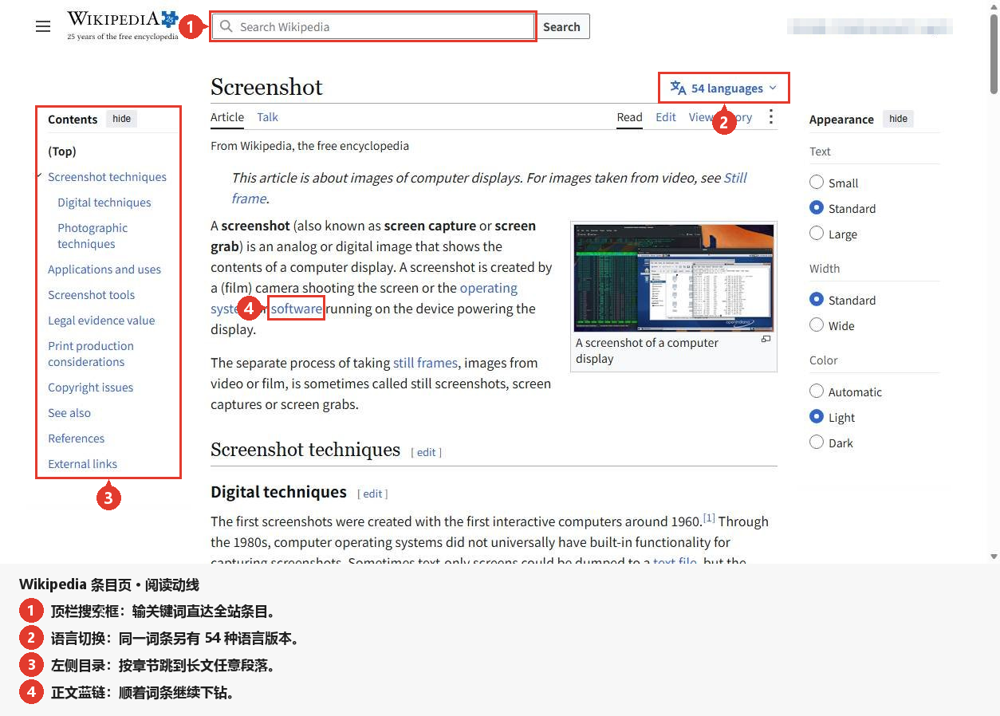
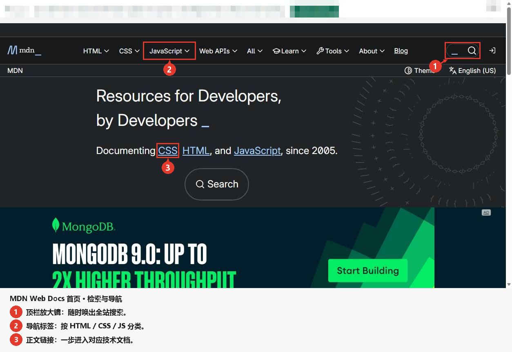

# screenshotpro

[English](README.md) | **中文**

**坐标只测不估的界面截图标注工具。**

<p align="center">
  
</p>

<p align="center"><sub>
那张图里的每一个矩形都是测出来的，不是画出来的 —— 而且它之所以能发布，是因为 15 条断言全部通过。
</sub></p>

你给它一个 Windows 程序的可执行文件：它启动程序、用 `PrintWindow` 抓下整窗截图、导出完整的
UI Automation 控件树，并把两者都存下来。之后 JSON spec 只说明**要标哪个控件**，从不写**它在哪**。
渲染器据此生成一张图：高亮框、编号徽标、箭头、马赛克打码，以及底部图例条；校验器再用 15 条断言
证明这张图是对的，任何一条不成立就以非 0 退出码失败。

它以两种互不依赖的形态交付：

| 形态 | 你得到什么 | 需要 DSH 吗 |
|---|---|---|
| **纯命令行** | `python tools/render.py` + `tools/verify.py`（Windows 上再加 `tools/measure_win.py`） | 不需要 —— Python 3.9+ 与 Pillow 即可 |
| **DSH 插件包** | 一个 `Screenshot Pro` 的 agent preset，挂载本仓的 skill 和它需要的工具 | 需要 —— 任意 DSH 宿主 |

---

## 目录

- [演示图](#演示图)
- [全仓唯一的铁律](#全仓唯一的铁律)
- [能力表](#能力表)
- [安装](#安装)
- [最小可复现例子](#最小可复现例子)
- [spec.json 字段参考](#specjson-字段参考)
- [dump.json 字段参考](#dumpjson-字段参考)
- [15 条断言](#15-条断言)
- [目录结构](#目录结构)
- [已知限制](#已知限制)
- [常见问题](#常见问题)
- [许可证](#许可证)

## 演示图

下面这两张图都渲染自**公开网页**，每一个矩形都来自真实 DOM（`getBoundingClientRect`）——
两个 `spec.json` 里没有任何一个坐标是手敲的。两张图都可以用 `demo/` 里已提交的文件离线复现：

```bash
python tools/render.py demo/wikipedia/spec.json && python tools/verify.py demo/wikipedia/spec.json
python tools/render.py demo/mdn/spec.json       && python tools/verify.py demo/mdn/spec.json
```

### Wikipedia —— 一条穿过条目的阅读路径


四步：顶栏搜索框、语言切换器、左侧目录、正文里的一个行内链接。
账户区域做了马赛克。注意文字放在哪儿：所有说明都落在**底部的图例条**里，条目正文一个像素都没被盖住。

### MDN —— 搜索与导航



三步：搜索胶囊、JavaScript 导航标签、首屏里的一个行内链接。第三方广告条做了马赛克。
这张图是在开启可选开关 `style.badge_avoid_dense_pixels` 的情况下渲染的 ——
为什么它在这张图上有效、在 Wikipedia 那张上**无效**，见 `demo/README.md`。

## 全仓唯一的铁律

> **坐标只测不估。**

图上的每一个矩形都来自 `dump.json` 里的 UI Automation 数据。没有任何一个是被手调、缩放或
「差一点点，挪一下」出来的。如果某个矩形不对，那是**测量**环节的 bug —— 不在 spec 里，更不
在渲染器里。这条规矩也是整条流水线能被验证的前提：断言 3 会逐字段比对报告与 dump，
断言 8 会在框落到空白像素上时失败 —— 那正是「坐标是估的」的典型症状。

## 能力表

| 阶段 | 命令行 | 读 | 写 | 契约 |
|---|---|---|---|---|
| 测量 | `python tools/measure_win.py --exe <app.exe> --out figures/<name>` | 正在运行的程序（UI Automation） | `shot.png`、`dump.json`、`measure-log.txt` | `dump.schema = uia-dump/1`，`shot` 尺寸 == 窗口矩形，`image_rect == screen_rect - window origin` |
| 渲染 | `python tools/render.py figures/<name>/spec.json` | `spec.json`、`shot.png`、`dump.json` | `out/<name>.png`、`out/render-report.json` | `spec.schema = annot-spec/1`，输出宽度 == 输入宽度 |
| 校验 | `python tools/verify.py figures/<name>/spec.json` | spec、dump、report、渲染出的 PNG | 一张 PASS/FAIL 表 | 只有 15 条断言全部通过才 exit `0` |
| 自测 | `python tests/run_tests.py` | 什么都不读 —— 它自己造合成 fixture | 临时目录里的 fixture + 图 | 15/15 PASS，外加一份故意改坏、**必须 FAIL** 的报告 |

出图能力：带内边距的高亮框；会互相避让、并且拒绝压住控件的圆形编号徽标；从徽标指向框边的箭头；
对实测控件矩形做 `pixelate` 马赛克打码；以及在截图下方追加一条自动算高度的图例条
（画布宽度永不改变）。

## 安装


- <code>npx screenshotpro ...</code> —— 一条命令覆盖 render / verify / measure / self-test；
- 这个包**本身就是 DSH 插件**：<code>pnpm add screenshotpro</code> 就等于装了插件，之后把
  <code>screenshotpro</code> 加进 profile 的 <code>dsh.profile.bundles</code>，并按下文改那一行
  <code>customSkillDirs</code>。


### 作为 DSH 插件

三种来源，结果一样 —— 你手上有什么就用哪种：

```bash
pnpm add screenshotpro                                    # 从 npm registry 装（最短）
```

然后在同一个 profile 目录（`~/.dsh/profiles/<名字>/`）里做两件事：

1. 在 `package.json` 的 `dsh.profile.bundles` 里加上 `screenshotpro`
2. 把下面那一行 `customSkillDirs` 改成这个包 `skills/` 目录的**绝对路径**

重启 DSH：preset 列表里出现 `Screenshot Pro`，技能目录里出现 `screenshot-pro`。
不需要编译、不需要打包 —— 这个包就是 Python 源码加一个 YAML 补丁。

`package.json` 声明了 `dsh.bundle.patch`，`cordis.patch.yml` 插入一个 agent preset
（`Screenshot Pro`），它挂载 `@deepseek-ai/dsh-persona`、`@deepseek-ai/dsh-tool-skill`、
`@deepseek-ai/dsh-skill-filesystem`、当前平台的 shell、file/job/todo/ask-user 工具，
并把本仓的 `skills/` 目录加成一个技能根。

**安装前必须改一行。** `dsh-skill-filesystem` 对 `config.customSkillDirs` 的每一项都调用
`node:path.resolve()`，所以填相对路径会被解析到 DSH 宿主的进程工作目录，而不是这个包目录；
而且它不展开任何占位符
（源码依据：`dsh-skill-filesystem/lib/index.js` 里的 `customSkillDirs: z.array(z.string())`
与 `(config.customSkillDirs ?? []).map((root) => resolve(root))`）。把本仓 `skills/` 目录的
绝对路径填进去：

```yaml
          - id: skill-filesystem
            name: '@deepseek-ai/dsh-skill-filesystem'
            config:
              customSkillDirs:
                - '/home/me/screenshotpro/skills'   # <- 换成你的绝对路径
```

改完这个 preset 就完整了；像其它 bundle 一样把它加进 profile，`screenshot-pro` 这个技能
就会出现在会话的技能目录里。

## 最小可复现例子

最小的完整闭环不需要真实程序、也不需要联网。`tests/run_tests.py` 做的就是这件事，
你也可以手动三条命令走一遍：

```bash
python tools/make_fixture.py /tmp/fx      # 合成窗口 + dump.json + spec.json
python tools/render.py       /tmp/fx/spec.json
python tools/verify.py       /tmp/fx/spec.json
```

第三条命令的预期输出尾部 —— 十五行、全 `PASS`、退出码 `0`（下面是校验器自己的输出，原样照抄；
第 9 行最后才打印，因为它要读前面几行的结果）：

```text
[PASS] 1 spec 内每个 target selector 在 dump.controls 中恰好命中 1 条 -- 5 个 selector 全部唯一命中
[PASS] 2 目标 control 的 image_rect 完全落在 shot 尺寸内 -- 5 个目标均在界内
...
[PASS] 13 legend.height 容得下所有行(最大行底 <= shot.h + legend.height <= 输出高) -- legend.height 120, 画布 760
[PASS] 9 退出码约定(全过 0 / 任一失败 1) -- exit 0 (0 项失败)

结果: 15/15 断言通过 -> PASS (exit 0)
```

它渲染的 spec 就是普通 JSON（另见 `examples/minimal-spec.json`）：

```json
{
  "schema": "annot-spec/1",
  "figure": "main-window",
  "shot": "shot.png",
  "dump": "dump.json",
  "steps": [
    { "n": 1, "target": { "automation_id": "btnBrowse" }, "label": "Step 1: pick the input file." },
    { "n": 2, "target": { "automation_id": "btnRun" }, "label": "Step 2: start the run." }
  ],
  "redact": [ { "target": { "automation_id": "lblOutDir" }, "mode": "pixelate", "block": 12 } ],
  "legend": { "enabled": true, "title": "Operation order" },
  "output": "out/main-window.png"
}
```

## spec.json 字段参考

| 字段 | 类型 | 默认 | 含义 |
|---|---|---|---|
| `schema` | string | 必填 | 必须是 `annot-spec/1` |
| `dump` | path | 必填 | 测量阶段产出的 `dump.json`，相对 spec 文件 |
| `shot` | path | `dump.shot.file` | 截图，相对 spec 文件 |
| `figure` | string | `""` | 写进报告便于追溯 |
| `output` | path | 必填 | 渲染出的 PNG，相对 spec 文件 |
| `steps[].n` | int | 按顺序从 1 起 | 徽标编号，同时是图例行 id |
| `steps[].target` | object | 必填 | selector，`automation_id` / `name` / `path` / `index` 四选一 —— 必须恰好命中 1 个控件 |
| `steps[].label` | string | `""` | 图例文字；留空表示这一步不进图例 |
| `steps[].box` | bool | `true` | 是否画高亮框 |
| `steps[].arrow` | bool | `true` | 是否画徽标→框的箭头 |
| `redact[]` | list | `[]` | `{target, mode: "pixelate", block: 12}` —— 对实测控件矩形做马赛克 |
| `legend.enabled` | bool | `true` | 是否追加图例条 |
| `legend.title` / `row_h` / `pad_x` / `pad_y` / `bg` / `text_color` / `max_text_w` / `font_size` | — | 见 `tools/render.py` 里的 `STYLE_DEFAULTS` | 图例外观 |
| `style.*` | — | 见 `tools/render.py` | `font_path`、`font_size`、`badge_fill`、`badge_radius`、`box_color`、`box_width`、`box_pad`、`arrow_width`、`min_gap`、`badge_avoid_dense_pixels` …… |

## dump.json 字段参考

| 字段 | 含义 |
|---|---|
| `schema` | 必须是 `uia-dump/1` |
| `window.screen_rect` | 窗口在屏幕坐标系下的矩形；它的 `w`/`h` 必须等于图片尺寸 |
| `shot` | `shot.png` 的 `{file, width, height}` |
| `capture_check` | `{method, overlap, mean_abs_diff, suggested_offset}` —— 证明这次抓图不是过期的 |
| `controls[]` | 每个 UIA 节点一条：`index`、`depth`、`type`、`name`、`automation_id`、`path`、`screen_rect`、`image_rect` |
| `controls[].image_rect` | 以图片左上角为原点的像素坐标；`== screen_rect - window origin`，永不缩放 |

## 15 条断言

`tools/verify.py` 每条断言打印一行，任何一行失败就以 `1` 退出。

| # | 不变量 | 防的是什么事故 |
|---|---|---|
| 1 | 每个 `target` selector 恰好命中 1 个控件 | 选择器写错或写得含糊，悄悄标到别的控件上 |
| 2 | 每个 `image_rect` 完整落在 shot 内 | 框被画布边缘裁掉 |
| 3 | 报告的 `image_rect` 与 dump 的逐字段相等 | 渲染器里偷偷多了一次坐标换算 |
| 4 | 输出 PNG 宽度 == 输入宽度 | 图被缩放 |
| 5 | 徽标两两不重叠（圆心距 >= 2r） | 两个步骤编号糊成一团 |
| 6a | 徽标与控件的重叠面积 <= 阈值 | 徽标正好压住它指向的那段文字 |
| 6b | 报告的 `overlap_controls` 与实际遮挡一致 | 少报遮挡，把问题藏起来 |
| 6c | 没有徽标落在别的步骤的框里 | 读者把编号理解成别的步骤 |
| 7 | 箭头终点落在自己框边的容差内 | 箭头指向一片空白 |
| 8 | 被标注区域的像素 std > 阈值 | 框画在空白像素上 —— 也就是**坐标是估的** |
| 9 | 只有每一行都通过才 exit 0 | CI 把一张坏图判成绿的 |
| 10 | `height == shot.h + legend.height`，宽度不变 | 图例把截图顶位移或缩放 |
| 11 | 图例行的 id 集合 == 带 label 的步骤集合 | 图例漏行、重复行或多出孤儿行 |
| 12 | 图例文字非空且宽度放得进 `canvas - 2*pad_x` | 文字跑出画布 |
| 13 | `legend.height` 容得下每一行 | 最后一行被裁掉 |

## 目录结构

```text
screenshotpro/
  cordis.patch.yml              DSH bundle：插入 Screenshot Pro 这个 preset
  package.json                  npm 元数据 + dsh.bundle.patch
  tools/
    measure_win.py              启动 exe -> shot.png + dump.json + measure-log.txt
    uia_dump.ps1                measure_win.py 的 PowerShell / UI Automation 那一半
    render.py                   spec.json -> 标注好的 PNG + render-report.json
    verify.py                   15 条断言，PASS/FAIL 表，exit 0/1
    make_fixture.py             合成窗口 + dump + spec（不需要真实程序）
  skills/screenshot-pro/SKILL.md   给 agent 看的使用手册
  tests/run_tests.py             离线闭环：fixture -> 渲染 -> 校验
  examples/                      最小 spec 与 dump 形状，不含任何截图
  demo/                          用这些工具渲染出来的示例图
```

## 已知限制

- **只有测量阶段限定 Windows。** 渲染与校验是可移植的 Pillow 代码。
- **没有 OCR，也没有图像识别。** 工具从不猜测某个控件是什么；UI Automation 没暴露出来的东西
  就标不了 —— 如实说明，不要硬画。
- **不做 DPI 缩放。** dump 记录的是被捕获窗口的像素；跨 DPI 混用属于测量 bug，
  校验器只能抓到症状，抓不到病因。
- **默认字体是 Windows 字体**（`msyhbd.ttc`）；在别的平台上请传 `style.font_path`，
  否则渲染器会因为找不到字体而报错。
- **桌面锁屏 / 被完全遮挡时抓不了。** 交叉校验会发现屏幕上不是这个窗口（日志里 `on_top=False`，
  并给出盖在上面的进程名），此时工具按设计失败退出，不会落一张不可信的图。
- 所有东西都是离线的，任何脚本里都没有网络调用。

## 常见问题

**Q：`measure_win.py` 报 `cross-check mean_abs_diff ... coordinate frame mismatch` 怎么办？**
看同一份日志里的 `on_top=` 与 `top=` 字段。如果 `on_top=False`、`top=LockApp(...)` 之类，
说明那一刻屏幕被别的窗口（最常见是锁屏）盖着 —— 解锁桌面再跑一次即可，改任何抓图参数都没用。
如果 `on_top=True` 而 diff 仍然很大，那才是真正的坐标问题：检查 DPI 与窗口是否在两次抓图之间被移动。

**Q：为什么 `--capture-rounds` 默认是 3？** 窗口被搬到主屏后，屏幕并不一定立刻重绘；
每轮会重新抬升窗口、等它稳定，再抓一次并与 PrintWindow 的结果对账。3 次都不过才失败，
失败时不落 `shot.png` / `dump.json`。

**Q：徽标压住了网页正文文字怎么办？** 把 `style.badge_avoid_dense_pixels` 设为 `true`，
徽标会在允许的范围内改挑像素更空的位置；它默认关闭，因为对所有图都开并不总是更好。

**Q：只想校验、不想重渲染？** `python tools/verify.py <spec.json> --report <render-report.json>`。

## 许可证

MIT —— 见 `LICENSE`。仓库内置的 fixture 是合成的：没有真实程序截图、没有真实控件名、没有个人路径。
